<div align="center">

<picture>
  <source media="(prefers-color-scheme: dark)" srcset=".github/assets/banner-dark.svg">
  
</picture>

**Keep Laravel. Replace the disposable runtime underneath it.**<br>
Production lifecycle, isolation, observability, queues, and deployment tooling for Laravel 12 and 13 applications running on PAM.

[](https://packagist.org/packages/pushinbr/pam-laravel)

[](LICENSE)

[Install](#install) · [Operations](#quick-example) · [Lifecycle](#production-lifecycle) · [Releases](#zero-downtime-releases) · [Docs](#docs) · [Issues](https://github.com/push-in/pam-laravel/issues)

</div>

<a id="install"></a>
## <picture></picture> Install

In a Laravel application on PAM:

```sh
pam init my-app --template laravel
cd my-app
pam composer require pushinbr/pam-laravel
pam artisan pam:install
pam artisan pam:check-production
```

`pam:install` publishes the configuration and production manifests (`--preset=api`, `livewire`, `inertia` or `realtime`). The package also registers `pam artisan`, which runs Laravel Artisan inside PAM's embedded PHP.

<a id="quick-example"></a>
## <picture></picture> Operations

```sh
pam artisan pam:health
pam artisan pam:leaks
pam artisan pam:capacity --memory-mb=1024 --worker-mb=96
pam artisan pam:process up
pam artisan pam:process status
pam artisan pam:process restart queue
pam artisan pam:deploy /srv/app/releases/20260725-120000
pam artisan pam:deploy --local --rollback
pam artisan pam:remote status production
pam artisan pam:nightwatch
pam artisan pam:autoscale queue --cpu=80 --p95=400
pam artisan pam:mcp
```

The default endpoints are:

- `GET /__pam/health` for readiness and liveness;
- `GET /__pam/metrics` for bounded process telemetry.

Set `PAM_LARAVEL_OBSERVABILITY_TOKEN` to require a bearer token on metrics. The registry retains bounded route, query and state-violation data, preventing the observability layer itself from becoming a memory leak.

<a id="production-lifecycle"></a>
## <picture></picture> Production lifecycle

PAM Laravel adds a request state guard to the `web` and `api` middleware groups. It rolls back leaked transactions, forgets authenticated users, restores the process locale and clears resolved facades after every request. Use strict mode in CI to turn detected state leakage into a failed request:

```dotenv
PAM_LARAVEL_STATE_GUARD=true
PAM_LARAVEL_STATE_GUARD_STRICT=true
```

Application-specific cleanup can implement `Pam\Laravel\Contracts\LifecycleHook` and register it with `LifecycleManager`.

| | |
| --- | --- |
| **Role** | Framework integration |
| **This repository owns** | Laravel boot, request isolation, cleanup, diagnostics, and production commands |
| **Boundary** | Laravel conventions and its package ecosystem remain Laravel |

<a id="zero-downtime-releases"></a>
## <picture></picture> Zero-downtime releases

Prepare an immutable release inside `PAM_DEPLOY_ROOT`, run migrations and framework cache generation in the release, then activate it with `pam:deploy`. Activation uses an atomic symlink replacement and records the previous target for rollback. Destructive schema changes should follow expand/migrate/contract deployment discipline.

<a id="process-manifest"></a>
## <picture></picture> Process manifest

`pam.processes.json` represents commands as arrays, not shell strings. This keeps arguments unambiguous and avoids manifest command injection:

```json
{
  "processes": {
    "http": {
      "command": ["pam", "start", "pam.php", "--workers", "2"],
      "instances": 1
    }
  }
}
```

PAM's Laravel runtime remains conservative about request concurrency because Laravel applications and third-party packages can hold mutable process-global state. Scale with multiple isolated workers; certify lifecycle hooks under load before opting into more aggressive concurrency.

<a id="support-policy"></a>
## <picture></picture> Support policy

The compatibility matrix tests PHP 8.4 with the maintained Laravel 12 release and the current Laravel 13 release. The public compatibility registry lives in the main PAM repository.

See the full [production platform guide](https://github.com/push-in/pam/blob/main/docs/laravel-platform.md) for OTLP traces, Nightwatch, PAM Cloud and Forge operations, autoscaling, MCP, package certification and reproducible benchmarks.

<a id="docs"></a>
## <picture></picture> Docs

- [Laravel on PAM](https://push-in.github.io/pam-docs/laravel/overview/)
- [Production platform guide](https://github.com/push-in/pam/blob/main/docs/laravel-platform.md)
- [PAM Octane](https://github.com/push-in/pam-octane)

<a id="pam-ecosystem"></a>
## <picture></picture> Part of the PAM ecosystem

<p align="center"><picture>
  <source media="(prefers-color-scheme: dark)" srcset=".github/assets/pam-wordmark-dark.svg">
  
</picture></p>

PAM runs PHP natively on servers, desktops and phones. This repository is one piece of it.

| [**PAM**](https://github.com/push-in/pam) | [**PAM Desktop**](https://github.com/push-in/pam-desktop) | [**PAM Native**](https://github.com/push-in/pam-native) | [**Ecosystem**](https://github.com/push-in/pam#ecosystem) |
| --- | --- | --- | --- |
| the runtime and CLI | native desktop apps in PHP | native Android and iOS apps in PHP | every official package and plugin |

<sub>Docs: [push-in.github.io/pam-docs](https://push-in.github.io/pam-docs/introduction/) · [Issues](https://github.com/push-in/pam-laravel/issues)</sub>

<p align="center"><sub><a href="LICENSE">MIT License</a> · Made in Brazil by Pushin</sub></p>
